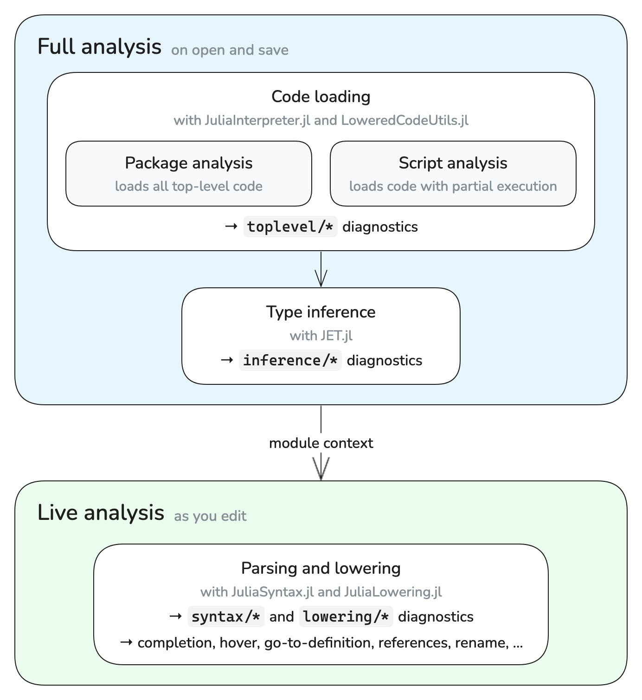
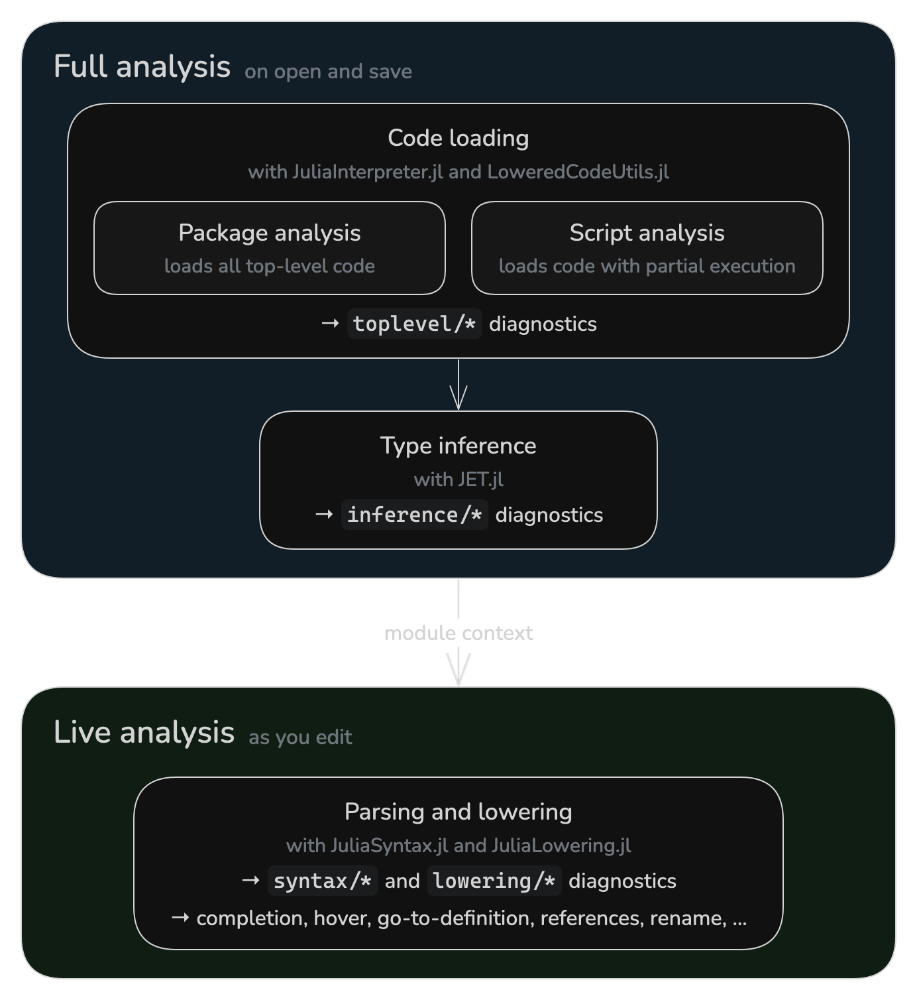

# [Analysis](@id analysis)

JETLS analyzes your code in two layers:

- **Full analysis** runs when you open or save a file. It loads your code,
  either as a package or as a script, and runs type inference on it, reporting
  `toplevel/*` and `inference/*` diagnostics.
- **Live analysis** runs as you edit. It parses and lowers each file,
  reporting `syntax/*` and `lowering/*` diagnostics, and powers language
  features such as completion and go-to-definition.

The two layers are connected by the module context: full analysis records the
module each part of a file is evaluated in, and live analysis uses it to
resolve the macros and global names that the file refers to. The following
diagram summarizes this structure:

```@raw html
<div class="display-light-only" style="max-width: 692px; margin: 0 auto;">
```

```@raw html
</div>
<div class="display-dark-only" style="max-width: 692px; margin: 0 auto;">
```

```@raw html
</div>
```

[Full analysis](@ref analysis/full) describes how JETLS loads your code and
which files it covers. [Live analysis](@ref analysis/live) describes how live
analysis depends on full analysis, including what remains available for files
that full analysis does not cover.

## [Full analysis](@id analysis/full)

Full analysis consists of two steps:

- Code loading:
  [JuliaInterpreter.jl](https://github.com/JuliaDebug/JuliaInterpreter.jl)
  interprets the top-level code to load your code, while
  [LoweredCodeUtils.jl](https://github.com/JuliaDebug/LoweredCodeUtils.jl)
  selects the code to execute in [script analysis](@ref analysis/full/modes/script).
  Loading stops at the first [top-level error](@ref diagnostic/reference/toplevel/error),
  and code after it is not analyzed.
  This step reports [`toplevel/*` diagnostics](@ref diagnostic/reference/toplevel).
- Type inference: [JET.jl](https://github.com/aviatesk/JET.jl) analyzes the
  loaded code based on Julia's type inference and reports [`inference/*` diagnostics](@ref diagnostic/reference/inference).

Both kinds of diagnostics are delivered through the
[`JETLS/save`](@ref diagnostic/source) source.

Full analysis works on analysis units. Each unit starts from an entry file,
such as the entry file of a package or a script, and covers the entry file and
every file reachable from it through `include`.

!!! danger "Security"
    Full analysis runs your top-level code and the dependency packages it
    loads, both of which can execute arbitrary code. Live analysis can also
    execute macro code during macro expansion. Neither layer is a sandbox;
    do not run JETLS on code you do not trust.

### [Full analysis modes](@id analysis/full/modes)

Full analysis loads an analysis unit in one of two ways. In both, the
dependency packages your code loads are loaded unconditionally. The comments
in the following example show which top-level code each mode executes:

```julia
using Statistics          # package: executed, script: executed
data = rand(10)           # package: executed, script: not executed
struct Point              # package: executed, script: executed
    x::Float64
end
norm2(p::Point) = p.x^2   # package: executed, script: executed
println(mean(data))       # package: executed, script: not executed
```

#### [Package analysis](@id analysis/full/modes/package)

Package analysis executes all top-level code of a package unconditionally,
then runs type inference on the loaded code. In the example above, it also
runs `println(mean(data))`, so an error in such code is reported as
[`toplevel/error`](@ref diagnostic/reference/toplevel/error).

#### [Script analysis](@id analysis/full/modes/script)

Script analysis loads a script with partial execution: it executes only the
top-level code needed to load definitions such as types, methods, and macros,
and runs type inference on the rest without running it. In the example above,
it defines `Point` and `norm2` but only infers `data = rand(10)` and
`println(mean(data))`, so an error in such code is reported as an
[`inference/*` diagnostic](@ref diagnostic/reference/inference).

Since script analysis does not execute such assignments, a definition that
needs the value of the assigned binding cannot be loaded unless that value
can be inferred. Otherwise, JETLS reports
[`toplevel/missing-concretization`](@ref diagnostic/reference/toplevel/missing-concretization):

```julia
read_config() = Base.get_bool_env("USE_FLOAT64", true; throw=true)
data = rand(read_config() ? Float64 : Float32, 10)
struct Samples
    values::typeof(data)  # toplevel/missing-concretization
end
```

See [`[full_analysis] concretization_patterns`](@ref config/full_analysis/concretization_patterns)
for how to let JETLS evaluate such bindings.

### [How loaded code is inferred](@id analysis/full/inference)

Type inference starts from two kinds of code and follows the calls from them:

- The methods that the analyzed code defines, each of which is inferred on its
  own (see [Signature analysis](@ref analysis/full/inference/signature)).
- The top-level code that [script analysis](@ref analysis/full/modes/script)
  does not execute, which is inferred in the order it is loaded.
  [Package analysis](@ref analysis/full/modes/package) executes all top-level
  code instead, so it does not infer the calls in top-level code.

Inference follows the calls into `Base` and other packages to infer what they
return, but JETLS reports only errors in the code of the analysis unit. An
error that occurs inside a function of another package is not
reported[^errors_in_other_packages], except for the errors of basic operations
such as field accesses, which are reported at the operation in your code:

```julia
struct Point
    x::Float64
end
gety(p::Point) = p.y                       # reported: `Point` has no field `y`
sum_strings(xs::Vector{String}) = sum(xs)  # not reported, although `sum` fails in `Base`
```

[^errors_in_other_packages]:
    When the cause of an error inside a function of another package is clearly
    in your code, such as `sum(xs)` for `xs::Vector{String}` above, JETLS may
    report the error at the call in your code in the future.

#### [Signature analysis](@id analysis/full/inference/signature)

Each method that the analyzed code defines is inferred on its own, from its
signature, with the declared types of its arguments and `Any` for the
arguments without declared types. So JETLS reports errors in a method even if
the analyzed code never calls it, as long as they occur for any values of the
declared types:

```julia
f(x) = sin(x)          # not reported: `x` can be a number
g(s::String) = sin(s)  # reported: `sin(::String)`, although `g` is never called
h(x) = sin("julia")    # reported regardless of `x`
```

Errors that depend on the types of the arguments without declared types, such
as the one in `f("julia")`, are reported only through
[call-site inference](@ref analysis/full/inference/call-site).

#### [Call-site inference](@id analysis/full/inference/call-site)

When inference reaches a call, it infers the called method with the argument
types of the call. An error found in the called method is reported where it
occurs, and the related information of the diagnostic shows the calls that lead
to it:

```julia
k(x) = cos(x)  # reported: `cos(::String)`, with the call below as the entry
k("julia")
```

Inference also reaches your code through functions of other packages, e.g. the
`do` block passed to `foreach`. It does not follow a call whose callee it
cannot determine, such as a call through `invokelatest`, so the code reached
only through such calls is not analyzed with the argument types of the call:

```julia
m(x) = tan(x)  # not reported, since inference does not follow the call below
(@main)(::Vector{String}) = invokelatest(m, "julia")
```

#### [Closures](@id analysis/full/inference/closures)

A closure, including a `do` block, is analyzed with the types of the variables
it captures, where the types of its arguments are known:

```julia
function f(name::String)
    foreach(1:3) do i                  # analyzed where `foreach` calls it, with `i::Int`
        println(name, i)
    end
    g = () -> sin(name)                # analyzed where it is created: reports `sin(::String)`
    h = (n::Integer) -> sin(name) + n  # likewise, since its argument type is declared
    k = n -> sin(name) + n             # analyzed only where the analyzed code calls it
    return g, h, k
end
```

- A closure whose argument types are all declared, including one that takes no
  arguments, is analyzed where it is created, even if the analyzed code never
  calls it. An explicit `::Any` counts as undeclared.
- Any other closure is analyzed only through
  [call-site inference](@ref analysis/full/inference/call-site), since the
  types of its arguments are known only there. Such a closure that the analyzed
  code never calls, e.g. one that is only returned or stored for later use, is
  not analyzed.
- The body of a task, e.g. of `@async` or `Threads.@spawn`, is analyzed where
  the task is created.

### [How each file is analyzed](@id analysis/full/files)

JETLS classifies a file by the nearest `Project.toml` found by searching
upward from the file's directory, and by the file's location relative to it.
Here, a package is a directory whose `Project.toml` has a `name` entry. The
class determines the entry file of the analysis unit the file belongs to, the
[analysis mode](@ref analysis/full/modes) that loads the unit, and the
environment the unit is loaded in:

| File                                                                    | Entry file         | Analysis mode                                        | Environment                  |
| :---------------------------------------------------------------------- | :----------------- | :--------------------------------------------------- | :--------------------------- |
| [Under `src/` of a package](@ref analysis/full/files/package-source)    | `src/<name>.jl`    | [Package analysis](@ref analysis/full/modes/package) | The package environment      |
| [Under `test/` of a package](@ref analysis/full/files/package-test)     | `test/runtests.jl` | [Script analysis](@ref analysis/full/modes/script)   | The package test environment |
| [Under `ext/` of a package](@ref analysis/full/files/package-extension) | —                  | No full analysis                                     | —                            |
| [Elsewhere in an environment](@ref analysis/full/files/script)          | The opened file    | [Script analysis](@ref analysis/full/modes/script)   | The nearest environment      |
| [Without a `Project.toml`](@ref analysis/full/files/script)             | The opened file    | [Script analysis](@ref analysis/full/modes/script)   | No project                   |

An analysis unit consists of its entry file and the files reached through
`include` from it. Some documents are handled differently; see
[Unsaved buffers and notebooks](@ref analysis/full/files/unsaved),
[Files outside the workspace root](@ref analysis/full/files/outside-root),
and [`jetls check`](@ref analysis/full/files/cli).

#### [Package source files](@id analysis/full/files/package-source)

Files under the `src/` directory of a package are analyzed together through
the package entry file, `src/<name>.jl`, or the file given by the `entryfile`
entry of the `Project.toml`, with the
[package analysis mode](@ref analysis/full/modes/package) in the package
environment. Files under `src/` that the package does not `include` are not
covered by full analysis, and JETLS reports
[`toplevel/analysis-skipped`](@ref diagnostic/reference/toplevel/analysis-skipped)
for them (see [Files without full analysis](@ref analysis/live/fallback)).

#### [Package test files](@id analysis/full/files/package-test)

Files under the `test/` directory of a package are analyzed together through
`test/runtests.jl`, with the
[script analysis mode](@ref analysis/full/modes/script) in the package test
environment: the environment of `test/Project.toml` if the package has one
without a `name` entry, e.g. when the tests are a
[`[workspace]`](https://pkgdocs.julialang.org/v1/toml-files/#Workspaces)
member of the package, and the package environment otherwise. Files under
`test/` that `test/runtests.jl` does not `include` are not covered by full
analysis, and JETLS reports
[`toplevel/analysis-skipped`](@ref diagnostic/reference/toplevel/analysis-skipped)
for them (see [Files without full analysis](@ref analysis/live/fallback)).

#### [Package extension files](@id analysis/full/files/package-extension)

Files under the `ext/` directory of a package are not covered by full
analysis. JETLS reports
[`toplevel/analysis-skipped`](@ref diagnostic/reference/toplevel/analysis-skipped)
for them (see [Files without full analysis](@ref analysis/live/fallback)).

#### [Scripts](@id analysis/full/files/script)

The following files are analyzed as scripts, with the
[script analysis mode](@ref analysis/full/modes/script):

- Files in a package outside `src/`, `test/`, and `ext/`
- Files in an environment whose `Project.toml` has no `name` entry, unless
  that environment is a
  [package test environment](@ref analysis/full/files/package-test)
- Files without a `Project.toml` above them

A script is analyzed together with the files it `include`s. Opening a script
that no earlier analysis covers makes it the entry file of a new unit. For
example, if `scripts/main.jl` `include`s `scripts/utils.jl`, opening
`scripts/main.jl` analyzes both files together, while opening
`scripts/utils.jl` first analyzes it alone, without what `scripts/main.jl`
defines before `include`ing it. Once `scripts/main.jl` is analyzed, e.g. when
you open it, `scripts/utils.jl` belongs to its unit: its diagnostics come from
that analysis, and saving it reanalyzes the unit from `scripts/main.jl`.

A script is loaded in the environment of the nearest `Project.toml`. A script
without one is analyzed as `julia script.jl` would run it: dependency packages
are loaded from the default environment (e.g. `@v1.13`) and the standard
library. When the JETLS process has an active project, set with `--project`
given to Julia before `--` or with the `JULIA_PROJECT` environment variable,
they are loaded from it first, as `julia --project script.jl` would. The same
applies to the other documents that are analyzed without a project, such as
[files opened without a workspace folder](@ref analysis/full/files/outside-root).

```bash
# Analyze a standalone script with the packages of an environment
jetls --project=/path/to/env -- check script.jl
```

#### [Unsaved buffers and notebooks](@id analysis/full/files/unsaved)

- An unsaved (untitled) buffer[^unsaved_buffers] is analyzed with the
  [script analysis mode](@ref analysis/full/modes/script) in the environment
  of the workspace root.
- A notebook is analyzed with all its cells as a single script, with the
  [script analysis mode](@ref analysis/full/modes/script) in the environment
  of the notebook file (see [Notebook support](@ref notebook)).

[^unsaved_buffers]:
    How unsaved buffers are represented depends on the client. JETLS supports
    unsaved buffers with the following URI schemes:
    - `untitled:` (VSCode and VSCode-based editors)
    - `buffer:` (Sublime Text)

#### [Files outside the workspace root](@id analysis/full/files/outside-root)

Files outside the workspace root, such as the source of a dependency opened
through go-to-definition, are not covered by full analysis (see
[Files without full analysis](@ref analysis/live/fallback)).

When a file is opened without a workspace folder, there is no workspace root,
and the file is analyzed as a
[script without a project](@ref analysis/full/files/script), regardless of
the `Project.toml` files above it.

#### [`jetls check`](@id analysis/full/files/cli)

[`jetls check`](@ref cli-check) classifies files in the same way, except that
it also analyzes files outside the root path (see
[Input paths and analysis mode](@ref cli-check/input)).

### [When full analysis runs](@id analysis/full/timing)

Full analysis works on whole units. JETLS requests it in the following cases:

- When you open a file that no full analysis covers yet. Opening a file that
  an earlier analysis already covers, e.g. another file of an analyzed
  package, reuses that result.
- When you save a file. JETLS schedules reanalysis of the unit the file belongs
  to, such as the entire package for a package source file. Saves are debounced
  per unit: JETLS waits for
  [`[full_analysis] debounce`](@ref config/full_analysis/debounce) seconds
  without another save in that unit before queuing the request.
- For unsaved buffers, which are never saved, after each edit, with a fixed
  debounce of 3 seconds.
- For notebooks, when the notebook is opened and when it is saved.
- When [`[full_analysis] concretization_patterns`](@ref config/full_analysis/concretization_patterns)
  changes, for every analyzed unit containing a file that an added or removed
  pattern applies to. Package source analysis is not rerun, since it evaluates
  all top-level code regardless of these patterns.
- When [`[full_analysis] concretization_timeout`](@ref config/full_analysis/concretization_timeout)
  changes, for every unit that has been analyzed.

Reanalysis is skipped if any previously analyzed file in the unit has a saved
syntax error. This can prevent full-analysis diagnostics from updating even
when you save another, syntactically valid file in the same unit. Fix the
syntax errors and save the affected files to allow full analysis to run again.

The first full analysis in a package environment may require the environment
to be instantiated. See
[`[full_analysis] auto_instantiate`](@ref config/full_analysis/auto_instantiate)
for how JETLS handles that.

### [Excluding files from full analysis](@id analysis/full/exclude)

The [`analysis_overrides`](@ref init-options/analysis_overrides)
initialization option excludes the matched files from full analysis:

```toml
[[initialization_options.analysis_overrides]]
path = "test/fixtures/**"
```

An excluded file reports
[`toplevel/analysis-skipped`](@ref diagnostic/reference/toplevel/analysis-skipped)
at its first line, which names the matched pattern. If the entry file of a
package or its tests is excluded, the other files of that analysis unit are
not analyzed either, and report the same diagnostic naming the entry file.

If full analysis reaches an `include` of a matched file, it reports
[`toplevel/analysis-stopped`](@ref diagnostic/reference/toplevel/analysis-stopped)
at the call site and stops the entire analysis unit before loading that file.
Code after that point and method bodies are not analyzed; diagnostics from
top-level code before the `include` are kept. Disabling the warning
through diagnostic settings does not change this behavior.

When the code after the `include` does not depend on the matched file, set
`on_include = "skip"` to continue the analysis without loading the file
instead. Full analysis then reports
[`toplevel/analysis-skipped`](@ref diagnostic/reference/toplevel/analysis-skipped)
at the call site and analyzes the rest of the unit as usual:

```toml
[[initialization_options.analysis_overrides]]
path = "test/test_expensive.jl"
on_include = "skip"
```

Excluded files are handled as described in
[Files without full analysis](@ref analysis/live/fallback).

!!! warning
    `analysis_overrides` is provided as a temporary workaround and may be
    removed or changed at any time.

## [Live analysis](@id analysis/live)

Live analysis parses and lowers your code with
[JuliaSyntax.jl](https://github.com/JuliaLang/julia/tree/master/JuliaSyntax)
and [JuliaLowering.jl](https://github.com/JuliaLang/julia/tree/master/JuliaLowering),
without loading the file as a package or script. Macro expansion can still
execute macro code. Live analysis reports
[`syntax/*`](@ref diagnostic/reference/syntax) and
[`lowering/*`](@ref diagnostic/reference/lowering) diagnostics, delivered
through the [`JETLS/live`](@ref diagnostic/source) source, and powers most
language features, such as completion, hover, go-to-definition, references, and
rename.

Live analysis runs whenever the contents of an open file change. It also
analyzes files you have not opened, as long as full analysis covers them, e.g.
the other files of a package once you open one of them (see
[`[diagnostic] all_files`](@ref config/diagnostic/all_files)).

Since live analysis takes the module context from full analysis, some of its
results depend on full analysis: the `lowering/*` diagnostics that depend on
the module context, such as
[`lowering/undef-global-var`](@ref diagnostic/reference/lowering/undef-global-var),
are reported only once full analysis has established the module context of the
file. JETLS then refreshes the live diagnostics to include them, so they appear
without further edits. Global names are likewise resolved against the
definitions that full analysis has loaded, except that completion of global
names also offers the global names defined by the current contents of files
in the same analysis unit. Hover and type inlay hints also run type inference
on the current top-level form on demand in that context.

### [Files without full analysis](@id analysis/live/fallback)

Full analysis does not cover the following files:

- Files outside the workspace root, such as the source of a dependency opened
  through go-to-definition
- [Package extension files](@ref analysis/full/files/package-extension)
- Files that are not reachable through `include` from the entry file of any
  analysis unit, such as a file under `src/` that the package does not include
- Files excluded with [`analysis_overrides`](@ref init-options/analysis_overrides),
  and the files of a package or its tests whose entry file is excluded
- Any file until its first full analysis completes

For these files, live analysis uses a fallback module context in place of the
one full analysis would establish. The fallback context provides the names of
`Base` and of the `Test` standard library, but none of the names the file itself
imports. As a result:

- [`syntax/*` diagnostics](@ref diagnostic/reference/syntax) and the
  `lowering/*` diagnostics that do not depend on the module context, such as
  unused or undefined local variables and unreachable code, are reported as
  usual.
- The `lowering/*` diagnostics that depend on the module context, such as
  [`lowering/undef-global-var`](@ref diagnostic/reference/lowering/undef-global-var),
  [`lowering/unused-import`](@ref diagnostic/reference/lowering/unused-import),
  and [`lowering/macro-expansion-error`](@ref diagnostic/reference/lowering/macro-expansion-error),
  are not reported. Neither are `inference/*` diagnostics or `toplevel/*`
  diagnostics from code loading. For package extension files and files
  excluded with `analysis_overrides`,
  [`toplevel/analysis-skipped`](@ref diagnostic/reference/toplevel/analysis-skipped)
  explains why the file is not analyzed.
- Go-to-definition, references, and rename keep working for local variables,
  including inside `@testset` and other macros available in the fallback
  context. The arguments of other macro calls are analyzed approximately, as
  if they were written without the macro. For global names, these features
  only consider the file itself.
- Completion of global names offers the names available in the fallback context
  and the global names that the file itself defines.
- Hover and type inlay hints may give incomplete results.
